  

<h1 align="center">Building software with purpose.</h1>

  <strong>Lewis · Independent Developer · Colombia</strong>

  Construyo productos digitales, sistemas de automatización y herramientas de seguridad. 
  Mi objetivo es transformar problemas reales en soluciones tecnológicas útiles, 
  accesibles y preparadas para evolucionar.

  <code>PRODUCT ENGINEERING</code> ·
  <code>INTELLIGENT AUTOMATION</code> ·
  <code>APPLICATION SECURITY</code>

---

## 01 / FEATURED PROJECT

### Universal Downloader Pro

Aplicación de escritorio diseñada para descargar, gestionar y organizar medios compatibles mediante una experiencia moderna basada en React, Electron y yt-dlp.

`Electron` `React` `Vite` `yt-dlp`

[Explorar repositorio](https://github.com/codelewix/Universal-Downloader-Pro) ·
[Visitar proyecto](https://universal-downloader-pro.vercel.app)

---

## 02 / SELECTED WORK

<table>
  <tr>
    <td width="50%" valign="top">
      <h3><a href="https://github.com/codelewix/kevinos">KevinOS</a></h3>
      
Portafolio interactivo inspirado en un sistema operativo, diseñado para explorar proyectos y aplicaciones.

      <code>TypeScript</code> <code>UI Engineering</code>
    </td>
    <td width="50%" valign="top">
      <h3><a href="https://github.com/codelewix/cinegram">CineGram</a></h3>
      
Plataforma de descubrimiento de películas, series y anime basada en metadatos de TMDB.

      <code>React</code> <code>TMDB</code> <code>Alpha</code>
    </td>
  </tr>
  <tr>
    <td width="50%" valign="top">
      <h3><a href="https://github.com/codelewix/bible-verbo">Verbo Bible</a></h3>
      
Experiencia móvil de lectura y estudio bíblico con aprendizaje asistido por inteligencia artificial.

      <code>React Native</code> <code>Expo</code> <code>Supabase</code>
    </td>
    <td width="50%" valign="top">
      <h3><a href="https://github.com/codelewix/wp-api-protection">REST API Protection</a></h3>
      
Herramientas de protección para la REST API de WordPress, orientadas al control de acceso y la prevención de abuso.

      <code>PHP</code> <code>WordPress</code> <code>Security</code>
    </td>
  </tr>
  <tr>
    <td width="50%" valign="top">
      <h3><a href="https://github.com/codelewix/telegram-media-downloader">Telegram Media Downloader</a></h3>
      
Sistema automatizado para procesar y gestionar medios mediante Telegram.

      <code>Python</code> <code>Telegram</code> <code>Docker</code>
    </td>
    <td width="50%" valign="top">
      <h3>Research & Development</h3>
      
Exploración de arquitectura de software, inteligencia artificial, automatización e infraestructura de datos.

      <code>R&D</code> <code>Architecture</code>
    </td>
  </tr>
</table>

---

## 03 / ENGINEERING STACK

### Languages

### Product Development

### Backend & Infrastructure

---

## 04 / ENGINEERING PHILOSOPHY

- Build with intent.
- Design for real people.
- Protect privacy and security.
- Prefer maintainable architectures.
- Automate repetitive processes.
- Learn through experimentation.
- Improve through iteration.

> Technology should solve problems, not create unnecessary complexity.

---

## 05 / CURRENT FOCUS

Actualmente exploro y desarrollo soluciones relacionadas con:

- Digital product engineering.
- Artificial intelligence and automation.
- Scalable data infrastructure.
- Mobile application development.
- Application security.
- Technology entrepreneurship.

---

## 06 / GITHUB TELEMETRY

  

  
View extended system telemetry

   
  

    
  

---

## 07 / CONNECT

  

---

  <strong>CODELEWIX</strong> 
  DESIGN THE SYSTEM. SHIP THE TOOL. ITERATE.

