<svg xmlns="http://www.w3.org/2000/svg" width="1200" height="330" viewBox="0 0 1200 330" role="img" aria-labelledby="title desc">
  <title id="title">codelewix — systems in progress</title>
  <desc id="desc">A dark terminal inspired banner with neon green interface details.</desc>
  <defs>
    <linearGradient id="bg" x1="0" y1="0" x2="1" y2="1">
      <stop offset="0" stop-color="#07110d"/>
      <stop offset="1" stop-color="#0b1713"/>
    </linearGradient>
    <pattern id="grid" width="32" height="32" patternUnits="userSpaceOnUse">
      <path d="M32 0H0V32" fill="none" stroke="#183126" stroke-width="1" opacity=".55"/>
    </pattern>
    <filter id="glow" x="-30%" y="-30%" width="160%" height="160%">
      <feGaussianBlur stdDeviation="5" result="blur"/>
      <feMerge><feMergeNode in="blur"/><feMergeNode in="SourceGraphic"/></feMerge>
    </filter>
  </defs>
  <rect width="1200" height="330" rx="18" fill="url(#bg)"/>
  <rect width="1200" height="330" rx="18" fill="url(#grid)"/>
  <rect x="1" y="1" width="1198" height="328" rx="17" fill="none" stroke="#254635"/>
  <path d="M0 60H1200" stroke="#254635"/>
  <circle cx="30" cy="30" r="6" fill="#ff5f57"/>
  <circle cx="52" cy="30" r="6" fill="#febc2e"/>
  <circle cx="74" cy="30" r="6" fill="#28c840"/>
  <text x="600" y="35" fill="#789587" font-family="Consolas,Monaco,monospace" font-size="13" text-anchor="middle">/home/codelewix/profile — zsh</text>
  <text x="78" y="137" fill="#68f0a4" font-family="Consolas,Monaco,monospace" font-size="17">$ whoami</text>
  <text x="78" y="203" fill="#e6fff0" font-family="Consolas,Monaco,monospace" font-size="54" font-weight="700" letter-spacing="-2">codelewix</text>
  <rect x="402" y="164" width="13" height="48" rx="2" fill="#68f0a4" filter="url(#glow)"/>
  <text x="80" y="250" fill="#9bb7a7" font-family="Consolas,Monaco,monospace" font-size="18">SOFTWARE  /  AUTOMATION  /  SECURITY</text>
  <text x="80" y="294" fill="#527361" font-family="Consolas,Monaco,monospace" font-size="13">BUILDING USEFUL THINGS, ONE SYSTEM AT A TIME.</text>
  <path d="M925 112h160l-34 34H891zM891 157h160l-34 34H857zM857 202h160l-34 34H823z" fill="none" stroke="#2d6347" stroke-width="2" opacity=".85"/>
  <path d="M1017 112h116v124h-150" fill="none" stroke="#68f0a4" stroke-width="2" opacity=".7"/>
  <circle cx="1133" cy="112" r="4" fill="#68f0a4"/>
</svg>


<p align="center">
  
</p>

<p align="center">
  <a href="https://github.com/codelewix"></a>
  <a href="https://universal-downloader-pro.vercel.app"></a>
</p>

## `$ whoami`

Soy **Lewis, también conocido como `codelewix`**. Construyo productos web y de escritorio, automatizaciones y herramientas de seguridad. Me interesa llevar una idea desde el prototipo hasta una experiencia que se pueda usar de verdad.

```text
FOCUS      product engineering · automation · application security
TOOLBOX    TypeScript · React · Python · Electron · Supabase · WordPress
MODE       prototype → ship → improve
```

## `$ ls ./featured-projects`

<table>
  <tr>
    <td width="50%" valign="top">
      <h3><a href="https://github.com/codelewix/Universal-Downloader-Pro">Universal Downloader Pro</a></h3>
      <p>Aplicación de escritorio para adquirir y organizar medios, con una interfaz React y Electron alrededor de yt-dlp.</p>
      <p><code>Electron</code> <code>React</code> <code>Vite</code> <code>yt-dlp</code></p>
      <a href="https://universal-downloader-pro.vercel.app">ABRIR PROYECTO</a>
    </td>
    <td width="50%" valign="top">
      <h3><a href="https://github.com/codelewix/kevinos">KevinOS</a></h3>
      <p>Portafolio interactivo con una interfaz de escritorio: ventanas, búsqueda, organización de proyectos e integración con GitHub.</p>
      <p><code>Web</code> <code>TypeScript</code> <code>UI engineering</code></p>
    </td>
  </tr>
  <tr>
    <td width="50%" valign="top">
      <h3><a href="https://github.com/codelewix/cinegram">CineGram</a></h3>
      <p>Explorador de películas, series y anime con metadatos de TMDB, perfiles locales y una experiencia de catálogo para streaming. Proyecto en alfa.</p>
      <p><code>React</code> <code>TMDB</code> <code>Product design</code></p>
    </td>
    <td width="50%" valign="top">
      <h3><a href="https://github.com/codelewix/bible-verbo">Verbo Bible</a></h3>
      <p>Aplicación móvil de lectura y estudio bíblico con herramientas de aprendizaje asistidas por IA y funciones de comunidad.</p>
      <p><code>React Native</code> <code>Expo</code> <code>Supabase</code> <code>Gemini</code></p>
    </td>
  </tr>
  <tr>
    <td width="50%" valign="top">
      <h3><a href="https://github.com/codelewix/wp-api-protection">REST API Protection</a></h3>
      <p>Suite de protección para la REST API de WordPress, con controles de acceso y defensas contra abuso automatizado.</p>
      <p><code>WordPress</code> <code>PHP</code> <code>Application security</code></p>
    </td>
    <td width="50%" valign="top">
      <h3><a href="https://github.com/codelewix/telegram-media-downloader">Telegram Media Downloader</a></h3>
      <p>Bot de Telegram que automatiza la descarga y el envío de medios mediante yt-dlp y herramientas relacionadas.</p>
      <p><code>Python</code> <code>Telegram</code> <code>Docker</code> <code>yt-dlp</code></p>
    </td>
  </tr>
</table>

## `$ cat ./currently-exploring.txt`

- Diseñar flujos completos, desde una interfaz clara hasta el backend que la sostiene.
- Automatizar tareas repetitivas con bots y herramientas pequeñas, enfocadas.
- Mejorar la seguridad y la privacidad de aplicaciones web.

## `$ git status --short`

```text
Projects: evolving
Ideas: compiling
Next step: keep building
```

<p align="center"><sub>CODELEWIX · SOFTWARE BUILT WITH INTENT</sub></p>
